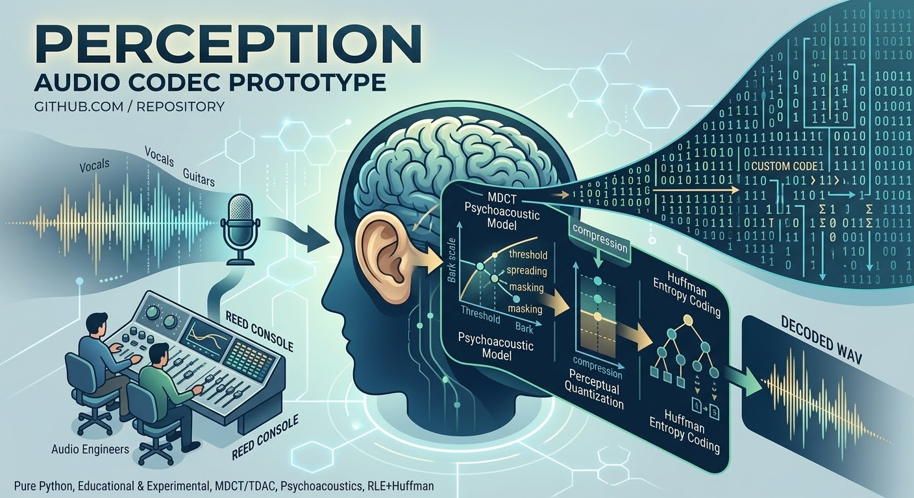

# Perception Audio Codec Prototype



Pure Python, educational and experimental. MDCT/TDAC, a simple psychoacoustic model, perceptual quantization, run-length coding, and Huffman.

This is not a drop-in replacement for MP3, AAC, or Opus. It is a readable prototype of that pipeline: overlap-add filterbank, masking thresholds, a noise allocator, then entropy coding.

## Pipeline

1. **Frame** the waveform with 2048-sample Kaiser–Bessel-derived windows, hopping by 1024.
2. **MDCT** with gain \\(\\sqrt{2/M}\\) on both analysis and synthesis so coefficients stay moderate and overlap-add still reconstructs.
3. **Psychoacoustic model** in Bark: spectral flatness for tonality, asymmetric spreading, and an absolute threshold in the same power units as the MDCT.
4. **Perceptual quantization** per scale-factor band. The step is the coarsest one whose mean-square error stays under the threshold, then widened so indices stay in \\(\\pm 2047\\).
5. **Rate control** re-quantizes the frame until the packed body fits a global bit reservoir at the target bitrate.
6. **RLE + Huffman**, written per frame so the reservoir measures the bytes that are actually stored.
7. **Decode** inverts that path and writes 16-bit PCM.

Bitstreams use the magic `PCD6`. They are not decodable by the older unnormalized `PCD5` tools.

## Requirements

- Python 3
- `numpy`
- `scipy`

## Usage

```bash
python perceptual_codec_5_6.py encode input.wav output.bit [target_kbps]
python perceptual_codec_5_6.py decode input.bit output.wav
python perceptual_codec_5_6.py selftest [outdir]
```

`target_kbps` defaults to 96. `selftest` checks middle-region MDCT perfect reconstruction, then encodes and decodes a two-second tone-plus-noise file and prints SNR, RMS ratio, and achieved bitrate.

## PCD6 package adapter

Use `perception_audio_codec.PCD6Encoder` to call the existing MDCT/TDAC + psychoacoustic + quantization + RLE/Huffman + rate-control implementation from Python:

```python
from perception_audio_codec import PCD6Encoder

codec = PCD6Encoder(target_kbps=96.0)
codec.encode_file("input.wav", "output.pcd6")
codec.decode_file("output.pcd6", "roundtrip.wav")
codec.selftest("codec-selftest")
```

This adapter intentionally delegates to `perceptual_codec_5_6.py` instead of creating a second incompatible PCD6 implementation. It is file-oriented and offline/worker-thread only, not a real-time streaming API. See [Docs/PCD6_ENCODER.md](Docs/PCD6_ENCODER.md).

## Processor API

The `perception_audio_codec` package provides validated PCM preparation and deterministic overlapping frame iteration for callers integrating the codec pipeline. It rejects empty/non-finite audio, explicitly defines mono channel selection, converts integer PCM to normalized floating point, and marks final-frame padding. See [Docs/PROCESSOR_API.md](Docs/PROCESSOR_API.md).

Run its tests with:

```bash
python -m unittest discover -s tests -v
```

## PAC1 encoder API

A separate offline baseline encoder is available in `perception_audio_codec.PerceptionEncoder`. It validates PCM, applies an orthonormal block DCT-II, band-wise adaptive quantization, and versioned PAC1 serialization with zlib compression. See [Docs/PAC1_ENCODER.md](Docs/PAC1_ENCODER.md) for usage and format limits.

**PAC1 is not PCD6.** This baseline uses block DCT-II rather than MDCT/TDAC, and does not claim a calibrated psychoacoustic model or fixed target bitrate. Codec work is intended for offline/worker-thread execution, never a real-time audio callback.

## Limits

- Mono only. Stereo input keeps channel 0 by default; the helper's average-downmix mode is explicit and opt-in.
- The masking model is a sketch (fixed spreading slopes, one tonality offset). It will not match a tuned AAC or MP3 encoder.
- Per-frame Huffman tables spend bits that a shared codebook would save. The reservoir accounts for that overhead; low targets get coarse steps.
- Perfect reconstruction holds for the unquantized transform. Quantization noise is what the threshold and the rate loop allow.
- The processor helper is an input/framing boundary; it is not a real-time audio callback or a claim of codec quality.

## LewSpEw integrated worker pipeline

The package now exports `PCD6Worker`, a bounded worker-thread wrapper that groups PCD6 file encode, decode, and self-test jobs behind Futures:

```python
from perception_audio_codec import PCD6Worker

with PCD6Worker(target_kbps=96, max_pending=8) as pipeline:
    result = pipeline.encode_file("input.wav", "output.pcd6")
    result.result()  # wait outside any audio callback
```

The worker is an offline orchestration layer. It uses Python's synchronized queue, **not a lock-free SPSC ring**, and must not be called from a WASAPI/ASIO real-time callback. The native in-memory PCM interface, lock-free SPSC rings, and hardware loopback validation remain separate work. See [Docs/LEWSPEW_PIPELINE.md](Docs/LEWSPEW_PIPELINE.md).
